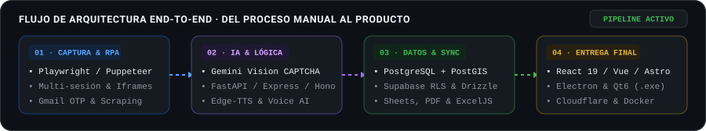
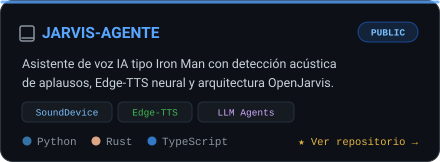
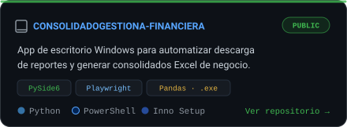
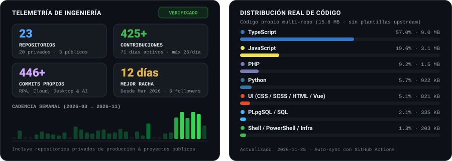

<p align="center">
  
</p>

<div align="center">

  [](https://github.com/00sebastian0011-netizen)

</div>

<p align="center">
  <a href="#sobre-mi"><code>Sobre Mí</code></a> ·
  <a href="#arquitectura"><code>Arquitectura</code></a> ·
  <a href="#tech-stack"><code>Tech Stack</code></a> ·
  <a href="#proyectos"><code>Proyectos</code></a> ·
  <a href="#metricas"><code>Métricas</code></a> ·
  <a href="#experiencia"><code>Experiencia</code></a> ·
  <a href="#conectar"><code>Conectar</code></a>
</p>

---

<a id="sobre-mi"></a>
## 🧑‍💻 Sobre Mí

<p align="center">
  
</p>

- 🏥 **RPA & Automatización HealthTech** en **MTD — Medicina y Terapias Domiciliarias**, transformando procesos operativos, facturación, glosas y auditorías clínicas en sistemas autónomos de alta confiabilidad.
- 🌐 **Desarrollo Full-Stack Cloud & Edge** de extremo a extremo: frontends con **React 19, TypeScript, Vue 3, Astro y MapLibre GL**, backends con **Node.js, Express 5, FastAPI, Hono (Cloudflare Workers), PHP 8.3** y **PostgreSQL / PostGIS / Supabase**.
- 🖥️ **Ingeniería de Aplicaciones Desktop (`.exe`)**: empaquetado profesional para Windows con **Electron (`electron-builder`)**, **PySide6 (Qt6)**, **PyInstaller**, **NSIS** e **Inno Setup**, incluyendo Chromium embebido listo para usuarios finales.
- 🧠 **IA Aplicada & Voz**: resolución visual de CAPTCHAs con **Google Gemini**, orquestación multi-modelo (**OpenAI / Claude**), bots headless **WebRTC/Jitsi** y síntesis neuronal (**Edge-TTS / ElevenLabs**).
- ⚡ **Fun fact**: Le enseñé a mi PC a responder con voz de **JARVIS** cuando aplaudo 👏.

---

<a id="arquitectura"></a>
## ⚙️ Cómo Construyo Software

<p align="center">
  
</p>

---

<a id="tech-stack"></a>
## 🛠️ Tech Stack & Ecosistema Técnico

<div align="center">

### 💻 Lenguajes Core


### 🌐 Frontend, Mapas & UI


### ⚡ Backend, Edge & Bases de Datos


### 🤖 RPA, Desktop & Inteligencia Artificial


</div>

<details>
<summary><b>🔍 Ver ecosistema adicional: QA, empaquetado Windows, APIs, documentos y DevOps</b></summary>
<br/>

<div align="center">


</div>

</details>

---

<a id="proyectos"></a>
## 🚀 Proyectos Destacados & Arquitectura en Producción

### 🌐 Repositorios Públicos

<p align="center">
  <a href="https://github.com/00sebastian0011-netizen/JARVIS-AGENTE"></a>&nbsp;&nbsp;<a href="https://github.com/00sebastian0011-netizen/CONSOLIDADOGESTIONA-FINANCIERA"></a>
</p>

<br/>

### 🏗️ Casos de Arquitectura en Producción *(20+ Repositorios Privados)*

| Vertical / Sistema | Impacto & Capacidades Clave | Stack Principal |
|---|---|---|
| 🏥 **Centro RPA MIPRES & Portales Clínicos** | Orquestador desktop + servidor local HTTP con sincronización en tiempo real hacia Google Sheets, validación de vigencias y suite de pruebas automatizadas. | `Electron` `React 19` `TypeScript` `Express 5` `Playwright` |
| 🧾 **Suite Facturación, Glosas & Respuesta IPS** | Bots RPA multi-módulo para extracción masiva de soportes (PDF, ZIP, Excel), captura de OTP vía Gmail OAuth2, manejo de `iframes`/postbacks y consolidación ejecutiva. | `Electron` `Playwright` `Puppeteer` `ExcelJS` `Gmail API` |
| 🤖 **Consulta Masiva ReTHUS con Visión IA** | Ejecución concurrente en navegadores paralelos, resolución inteligente de CAPTCHAs mediante **Google Gemini Vision** e impresión PDF directa con Chromium. | `Python` `FastAPI` `Playwright` `google-genai` `gspread` |
| ⚡ **Plataforma Geoespacial de Movilidad Eléctrica** | Mapa interactivo de estaciones de carga en Colombia con clustering GeoJSON, filtros reactivos, PostGIS y pipeline CI con lint/advisors de base de datos. | `React 19` `TypeScript` `MapLibre GL` `PostgreSQL 17` `PostGIS` `Supabase` |
| 🏃 **Plataforma Multi-Organizador de Eventos & Pagos** | Reservas transaccionales con expiración automática, confirmación de pagos vía webhooks **Mercado Pago**, mapa nacional (`d3-geo`) y aislamiento estricto por rol. | `React 19` `Supabase RLS` `Mercado Pago` `Zod` `Vitest` |
| ☁️ **Monorepo Edge, LMS Empresarial & Bots WebRTC** | APIs en **Cloudflare Workers + Hono + Drizzle**, extensiones **Moodle PHP 8.3** auditadas con **Axe-core**, y bots headless **Jitsi/SIP** escalados a 190+ participantes. | `Hono` `Cloudflare Workers` `Turborepo` `PHP 8.3` `WebSockets` `Docker` |

<details>
<summary><b>📦 Ver más soluciones construidas: Instaladores Windows, Web Corporativa, ATS & Mallas Operativas</b></summary>
<br/>

- **🖥️ Empaquetado Desktop sin dependencias**: Generación de instaladores Windows **NSIS** e **Inno Setup** (`Electron` y `PyInstaller`) con Chromium embebido, íconos personalizados, auto-detección de rutas de usuario y consola de logs en tiempo real (`INFO` / `ÉXITO` / `ERROR`).
- **📋 Portal de Mallas Operativas (`Electron + Vue 3`)**: Interfaz oscura con glassmorphism para automatizar accesos protegidos, monitoreo de conexión a Google Sheets y control instantáneo de ejecución.
- **👥 Plataforma ATS de Talento Humano (`Express 5 + Bizneo API`)**: Middleware con `Helmet`, `JWT`, `bcryptjs`, `express-rate-limit` y extracción automática de hojas de vida desde PDF y Word (`pdf-parse`, `mammoth`, `word-extractor`).
- **🌐 Web Corporativa & Comercial (`La Provincia Resort` & portales web)**: Desarrollo de sitios web responsivos con diseño moderno y enfoque comercial en `Astro`, `HTML5`, `CSS3`, `JavaScript` y `TypeScript`.

</details>

---

<a id="metricas"></a>
## 📊 Telemetría Real & Contribuciones

<p align="center">
  
</p>

### 🐍 Actividad de Contribuciones

<div align="center">
  <picture>
    <source media="(prefers-color-scheme: dark)" srcset="https://raw.githubusercontent.com/00sebastian0011-netizen/00sebastian0011-netizen/output/github-snake-dark.svg" />
    <source media="(prefers-color-scheme: light)" srcset="https://raw.githubusercontent.com/00sebastian0011-netizen/00sebastian0011-netizen/output/github-snake.svg" />
    
  </picture>
</div>

---

<a id="experiencia"></a>
## 💼 Experiencia Profesional & Trayectoria

```text
🏥 MTD — Medicina y Terapias Domiciliarias | Full-Stack & RPA Engineer
├── 🤖 Bots RPA de escritorio & headless para portales EPS, MIPRES, ReTHUS y facturación
├── 🖥️ Apps empaquetadas para Windows (.exe con Electron + React/Vue y Python PySide6)
├── 📊 Sincronización en tiempo real con Google Sheets API, Gmail OAuth2 y ExcelJS/Pandas
├── 🧠 Automatización asistida por IA (Gemini Vision para CAPTCHAs y análisis documental)
└── 👥 Herramientas internas de reclutamiento, auditoría, glosas y mallas operativas

☁️ Productos Cloud, Edge & Plataformas Web
├── ⚡ Backends serverless en Cloudflare Workers + Hono + Drizzle ORM + PostgreSQL/Neon
├── 🗺️ Plataformas geoespaciales en React 19 + TypeScript + MapLibre GL + PostGIS + Supabase
├── 💳 Flujos transaccionales seguros con Mercado Pago Webhooks, Zod y Row-Level Security
└── 🎓 Ecosistema LMS en PHP 8.3 (Moodle plugins/temas) + QA E2E con Playwright & Axe-core

🎙️ IA Aplicada, Bots WebRTC & Experimentación
├── 🔊 Asistente de voz JARVIS activado acústicamente por aplausos (SoundDevice + Edge-TTS)
├── 📡 Bots headless para conferencias Jitsi/WebRTC/SIP (190+ sesiones concurrentes + Docker)
└── 🤖 Integración multi-modelo con OpenAI, Google Gemini, Claude y ElevenLabs
```

---

<a id="conectar"></a>
## 📫 Conecta Conmigo

<div align="center">

[](https://github.com/00sebastian0011-netizen)
[](https://github.com/00sebastian0011-netizen)
[](https://github.com/00sebastian0011-netizen)


</div>

<br/>

<p align="center">
  
</p>
